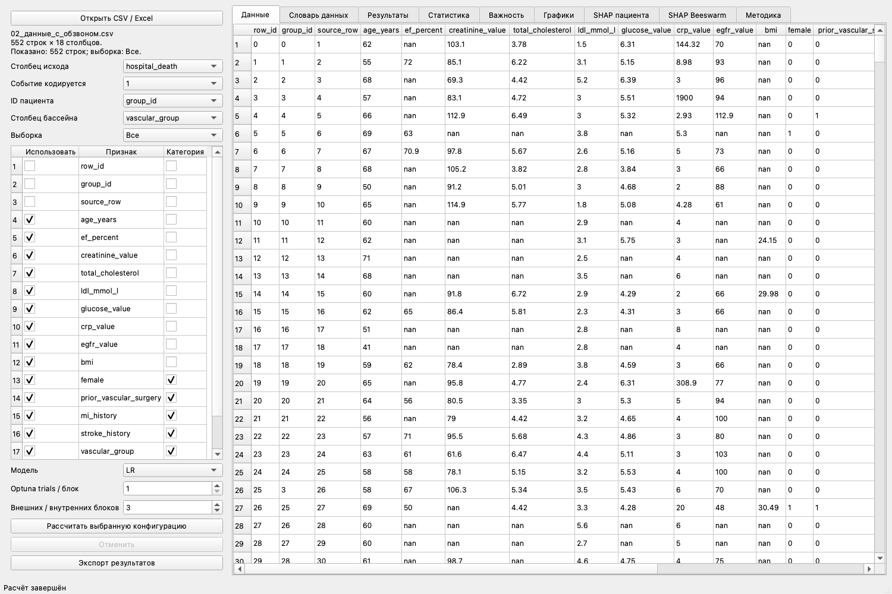
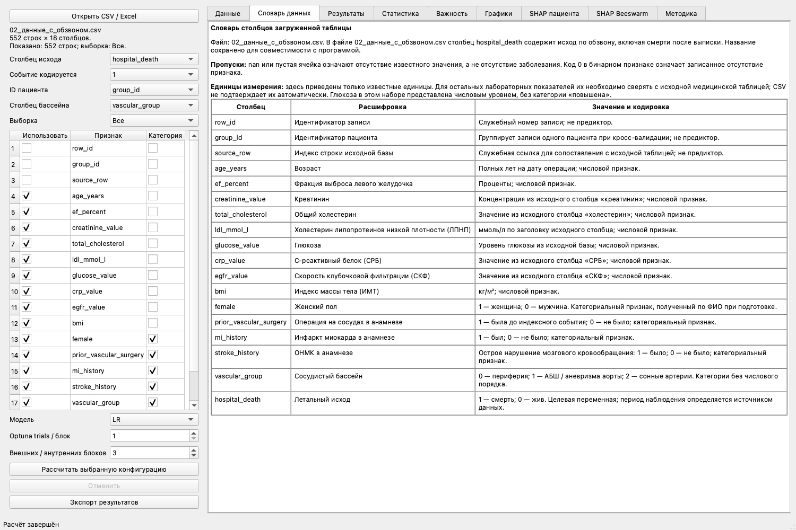
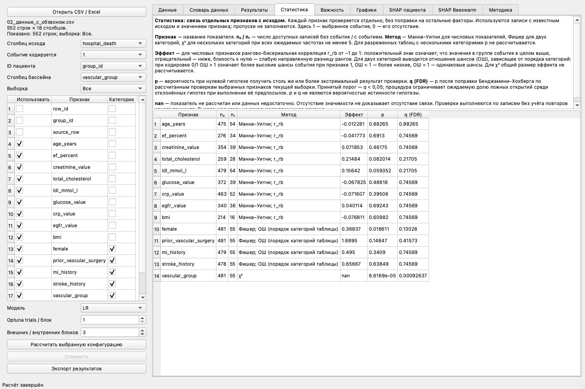
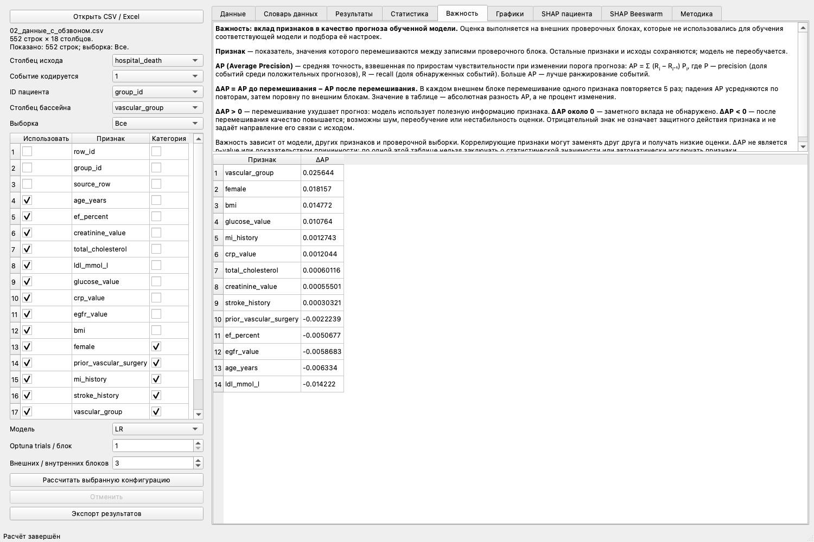
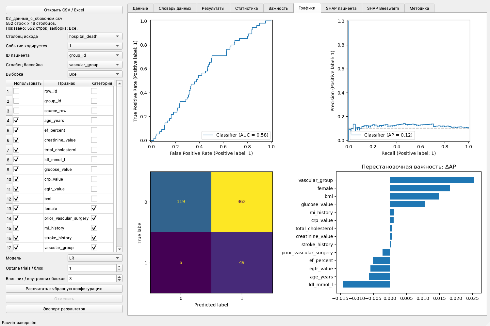
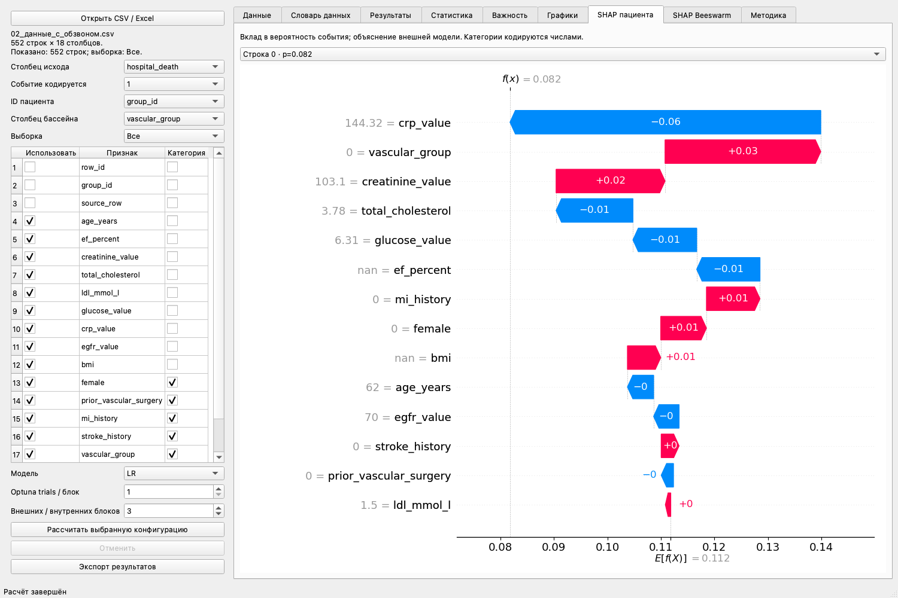
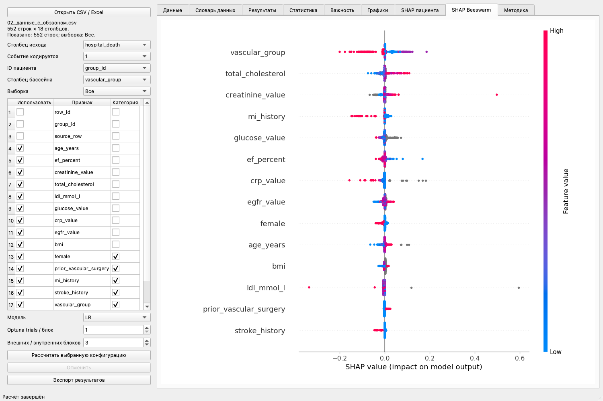

# Сосудистые исходы

Локальная программа на **Python и PySide6** для статистического анализа сосудистых исходов, обучения моделей и интерпретации прогнозов. Позволяет загрузить подготовленную таблицу, выбрать сосудистый бассейн и набор факторов, сравнить модели и сохранить результаты.

Программа работает в настольном окне. Сервер и подключение к внешним сервисам для анализа не нужны: данные обрабатываются на компьютере пользователя.

## Возможности

- CSV и Excel, просмотр всех строк и фильтрация по бассейнам.
- Словарь названий и кодировок столбцов подготовленного датасета.
- Включение и отключение предикторов, выбор числового или категориального типа.
- Манна–Уитни, точный критерий Фишера, χ² и поправка FDR.
- Логистическая регрессия (LR) и случайный лес (RF) с Optuna.
- Вложенная групповая кросс-валидация с разделением записей по пациентам.
- Метрики качества, ROC, Precision–Recall и матрица ошибок.
- Перестановочная важность, SHAP отдельной записи и SHAP Beeswarm.
- Экспорт таблиц, графиков и протокола расчёта.



Скриншоты получены в текущем интерфейсе после демонстрационного расчёта LR: 1 попытка Optuna на внешний блок, 3 внешних и 3 внутренних блока. Их значения иллюстрируют работу программы и не являются итоговым результатом исследования.

## Установка и запуск

Используйте Python 3.11 или 3.12. Перейдите в каталог проекта и выполните:

```sh
python3 -m venv .venv
source .venv/bin/activate
python -m pip install -r requirements.txt
python app.py
```

В Windows команда активации окружения:

```powershell
.venv\Scripts\Activate.ps1
```

После изменения кода закройте приложение и запустите `python app.py` повторно. В IDE выберите интерпретатор созданного `.venv`.

## Быстрый порядок работы

1. Нажмите **«Открыть CSV / Excel»** и выберите подготовленную таблицу.
2. Укажите исход и код события. Для текущего датасета — `hospital_death` и `1`.
3. Выберите ID пациента `group_id`, столбец бассейна `vascular_group` и нужную выборку.
4. Отметьте предикторы и их категориальный тип. Служебные ID и исход не используйте как факторы.
5. Выберите RF или LR, количество попыток Optuna и число блоков.
6. Нажмите **«Рассчитать выбранную конфигурацию»**. Ход работы отображается в строке состояния.
7. Изучите результаты. Для сохранения нажмите **«Экспорт результатов»**.

Изменение настроек не запускает пересчёт автоматически. После изменения выборки или признаков снова нажмите кнопку расчёта. До этого вкладки результатов относятся к последнему выполненному расчёту.

## Входные данные

Поддерживаются CSV с автоматическим определением разделителя, XLS и XLSX. В Excel читается **первый лист**, выбора листа пока нет. Полностью пустые строки, полностью пустые столбцы и столбцы `Unnamed…` удаляются при чтении. Заголовки очищаются от пробелов по краям.

Одна строка — запись наблюдения или госпитализации. Для повторных записей одного пациента задайте одинаковый ID.

- Исход должен содержать числовые `0`, `1` и пропуски. Даты и годы смерти заранее преобразуйте в `1`.
- Пропуск признака — неизвестное значение. Его не следует автоматически заменять нулём.
- Числовые предикторы должны содержать числа; десятичная запятая поддерживается при подготовке к обучению. Текстовые значения очистите либо отметьте признак как категориальный.
- ID пациента не должен иметь пропусков в используемых записях. Если ID не выбран, программа просит подтвердить независимость строк.
- Предикторы должны быть доступны на момент прогнозирования. Сведения о последующих событиях не включайте как исходные факторы.

### Текущий подготовленный датасет

Для обновлённого анализа используется `data/02_данные_с_обзвоном.csv`. Объединение источников выполнено отдельно: приложение читает готовый CSV и не требует скрипта объединения.

| Состав | Записей |
|---|---:|
| Всего | 552 |
| Известный исход | 536 |
| Живы | 481 |
| Умерли | 55 |
| Исход неизвестен или запись не сопоставлена | 16 |

| Код | Бассейн | Всего записей | Смертей |
|---|---|---:|---:|
| `0` | Периферия | 255 | 34 |
| `1` | АБШ / аневризма аорты | 103 | 16 |
| `2` | Сонные артерии | 194 | 5 |

Название **`hospital_death` сохранено для совместимости**, но в этом файле оно означает исход из столбца «летальный исход» листа «анкета» по обзвону, включая смерти после выписки. Прежние госпитальные смерти к нему не прибавляются. Это не исключительно госпитальная смертность и не анализ времени до события.

Сохранены предикторы первоначальных 531 записей и возвращена 21 ранее исключённая запись независимо от исхода. Неизвестные исходы оставлены пустыми: 13 записей не сопоставлены, в 3 сопоставленных исход неизвестен. Все 55 отметок смерти из анкеты учтены. Эти числа относятся к текущей версии CSV.

Для `data/02_данные_с_обзвоном.csv` добавлено исключение в `.gitignore`: подготовленный датасет можно включить в коммит обычным способом. Остальные CSV по-прежнему игнорируются. После включения этого файла в репозиторий он будет доступен вместе с проектом при клонировании.

## Настройки боковой панели

| Элемент | Назначение |
|---|---|
| **Столбец исхода** | Бинарная переменная для анализа и прогнозирования. |
| **Событие кодируется** | Значение положительного события. Для смерти в текущем CSV — `1`. Выбор `0` меняет анализируемое событие. |
| **ID пациента** | Группирует записи пациента при CV; не является предиктором. |
| **Столбец бассейна** | Столбец, формирующий список групп. |
| **Выборка** | «Все» или отдельная группа. Фильтрует предпросмотр и данные следующего расчёта. |
| **Использовать** | Включает признак в статистику и модель. |
| **Категория** | Задаёт категориальную обработку. Коды категорий не должны трактоваться как непрерывная величина. |
| **Модель** | `RF` — случайный лес; `LR` — логистическая регрессия с L2-регуляризацией. |
| **Optuna trials / блок** | Число проверяемых комбинаций гиперпараметров на каждый внешний блок, от 1 до 200. |
| **Внешних / внутренних блоков** | Одинаковое число блоков на обоих уровнях CV, от 2 до 5. |
| **Рассчитать выбранную конфигурацию** | Запускает расчёт с текущими настройками. |
| **Отменить расчёт** | Во время работы доступно действие в верхнем меню. Отмена проверяется между этапами; текущее обучение может завершиться перед остановкой. |
| **Экспорт результатов** | Сохраняет последний завершённый результат в новый каталог. |

Для знакомства подходит общая выборка, 10 попыток Optuna и 3 блока. Это начальная конфигурация, а не универсально оптимальная настройка. Больше попыток и блоков — дольше расчёт, без гарантии улучшения качества.

## Вкладки приложения

### Данные

Все строки доступны с прокруткой, ограничения в 100 строк нет. При смене «Выборки» предпросмотр обновляется, слева показывается число отображаемых записей. Номер строки слева сохраняет позицию записи в загруженной таблице.

`nan` означает пропуск. Если исходный файл упорядочен по бассейнам, в начале общей выборки могут идти записи только одного бассейна.

### Словарь данных

Расшифровка столбцов текущего файла: смысл показателя, кодировка, известные единицы и роль служебных полей. Для незнакомого имени выводится «Описание не задано». Единицы, не подтверждённые исходными заголовками, нужно сверять с источником.



### Результаты

Метрики рассчитаны по объединённым внешним проверочным прогнозам: каждая запись оценивается моделью, не обучавшейся на этом пациенте.

| Показатель | Как читать |
|---|---|
| **N** | Число использованных записей с известным исходом. |
| **Событий** | Число положительных исходов согласно выбранному коду. |
| **Исключено без исхода** | Записи выбранной выборки без известного исхода. |
| **AP** | Average Precision: качество ранжирования событий с учётом precision и recall; больше — лучше. Ориентир случайного ранжирования — доля событий. |
| **ROC AUC** | Способность ранжировать событие выше отсутствия события; 0,5 соответствует случайному ранжированию, 1 — идеальному. |
| **Brier** | Ошибка вероятностей: `mean((p − y)²)`; меньше — лучше. Сравнивается в том числе с постоянным прогнозом частоты события. |
| **Recall события** | Чувствительность: `TP / (TP + FN)`, доля обнаруженных событий. |
| **Специфичность** | `TN / (TN + FP)`, доля правильно определённых записей без события. |
| **Precision** | `TP / (TP + FP)`, доля истинных событий среди положительных прогнозов. |
| **Balanced accuracy** | Среднее чувствительности и специфичности. |

`TP` — обнаруженное событие, `FN` — пропущенное событие, `TN` — правильно определённое отсутствие события, `FP` — ложная тревога. Без положительных прогнозов программа выводит precision = 0.

Ниже показаны настройки каждого внешнего блока: `fold`, выбранные `params`, порог `threshold` и качество внутреннего подбора `inner_AP`. Итоговое внешнее AP и `inner_AP` оценивают разные этапы.

### Статистика

Каждый выбранный фактор сравнивается между группами исхода отдельно, без учёта остальных факторов. Пропуски не заполняются.

| Столбец | Значение |
|---|---|
| **Признак** | Проверяемый показатель. |
| **n₀ / n₁** | Число доступных записей без события / с событием. |
| **Метод** | Манна–Уитни для числового признака; Фишер для двух категорий; χ² для нескольких категорий при всех ожидаемых частотах ≥ 5. |
| **Эффект** | Рангово-бисериальная корреляция `r_rb` для числового признака или отношение шансов для бинарного. Для χ² общий размер эффекта не рассчитывается. |
| **p** | Вероятность столь же или более экстремального результата при нулевой гипотезе. |
| **q (FDR)** | p после поправки Бенджамини–Хохберга по рассчитанным проверкам выбранной выборки. Порог — `q < 0,05`. |

`r_rb > 0` означает более высокие ранги значений в группе события, `r_rb < 0` — более низкие. Для признака 0/1 отношение шансов больше 1 соответствует более высоким шансам события при признаке 1, меньше 1 — более низким. Для других категорий направление зависит от порядка строк таблицы сопряжённости.

Для разреженных таблиц с несколькими категориями p не рассчитывается. `nan` означает отсутствие рассчитанной величины. Проверки не учитывают зависимость повторных записей пациента. Отсутствие значимости не доказывает отсутствие связи; p и q не являются вероятностью истинности гипотезы.



### Важность

Перестановочная важность показывает, насколько модель использует признак на внешних проверочных данных:

```text
ΔAP = AP до перемешивания − AP после перемешивания признака
```

Перемешиваются значения одного признака, модель не переобучается. В каждом внешнем блоке выполняются 5 перемешиваний. Разности усредняются по повторам, затем поровну по внешним блокам. Это абсолютная разность AP, а не процент изменения.

- **ΔAP > 0:** перемешивание ухудшает прогноз, признак содержит полезную для модели информацию.
- **ΔAP около 0:** заметного вклада не обнаружено.
- **ΔAP < 0:** перемешивание улучшает прогноз; возможны шум, переобучение или нестабильность оценки.

Знак важности не означает повышение или снижение риска. Коррелирующие признаки могут заменять друг друга. Оценка не является p-value и сама по себе не служит основанием для исключения признака.



### Графики

| Положение | График | Назначение |
|---|---|---|
| Сверху слева | **ROC** | Чувствительность против доли ложноположительных прогнозов при разных порогах. |
| Сверху справа | **Precision–Recall** | Точность положительных прогнозов против чувствительности. Пунктир — доля событий. |
| Снизу слева | **Матрица ошибок** | Строки — фактический исход, столбцы — прогноз. 1 — выбранное событие, 0 — его отсутствие. |
| Снизу справа | **Перестановочная важность** | Графическое представление ΔAP. |

ROC и PR используют объединённые внешние вероятности. Матрица ошибок — внешние решения с порогами, выбранными отдельно для каждого блока.



### SHAP пациента

Выберите запись в списке. «Строка» — индекс записи загруженной таблицы, а не `group_id`: у пациента может быть несколько записей. `p` — внешняя прогнозируемая вероятность события.

Waterfall показывает переход от базовой вероятности к прогнозу записи. Положительные вклады увеличивают вероятность события, отрицательные уменьшают:

```text
Прогноз вероятности = базовое значение + сумма вкладов SHAP
```

Объясняется полный пайплайн внешней модели, включая обработку пропусков. Вклады выражены в шкале вероятности, а не логарифма шансов. Они описывают поведение модели, а не причинное действие факторов.



### SHAP Beeswarm

Общая диаграмма распределения вкладов:

- Строка — признак; порядок определяется средней абсолютной величиной SHAP.
- Точка — запись; горизонтальное положение — вклад в вероятность события.
- Цвет показывает величину признака; для категорий используются технические коды, не клиническая порядковая шкала.
- Положительные вклады сдвигают прогноз к событию, отрицательные — от события.

Объединяются объяснения разных внешних моделей с разными базовыми значениями. Используется приближённый permutation SHAP: до 30 фоновых обучающих записей и бюджет `2 × число признаков + 1` на объяснение. Вклады являются приближёнными.



### Методика

Протокол обучения, статистических проверок, связь с исходным исследованием и ограничения. Вкладка расположена последней. Пояснения статистики и важности также находятся над соответствующими таблицами; высота областей меняется перетаскиванием разделителя.

## Как выполняется обучение

Используется **вложенная стратифицированная групповая кросс-валидация** (`StratifiedGroupKFold`). Группировка удерживает записи пациента вместе, стратификация стремится сохранить соотношение исходов.

1. Внешний блок откладывается для проверки.
2. В оставшейся обучающей части создаются внутренние блоки. Optuna TPE выбирает гиперпараметры по максимальному среднему внутреннему AP.
3. На внутренних проверочных прогнозах выбирается порог максимальной balanced accuracy, эквивалентный максимуму `чувствительность − доля ложноположительных`.
4. Модель обучается на всей внешней обучающей части и прогнозирует отложенный блок. На нём вычисляется перестановочная важность; SHAP объясняет внешние прогнозы с фоном из обучения.
5. После всех внешних блоков проверочные прогнозы объединяются для итоговых метрик.

**Обработка предикторов обучается внутри каждого train:** числовые пропуски заполняются медианой с индикаторами пропусков, затем применяется стандартизация. Категориальные пропуски заполняются модой, категории кодируются one-hot. Исходный файл не перезаписывается. «Статистика» использует незаполненные значения.

Для повторяемости заданы seed 2026 и фиксированные производные seed. При одинаковых данных, их порядке, настройках и окружении разбиения воспроизводимы. Изменение данных или числа блоков меняет разбиения.

При K блоках и T попытках только подбор требует примерно `K × T × K` обучений. Дополнительно выполняются обучение для выбора порога, внешние модели, важность и SHAP.

### Пространства поиска Optuna

| Модель | Параметр | Диапазон |
|---|---|---|
| RF | `n_estimators` | 200–800 с шагом 100 |
| RF | `max_depth` | 2–8 |
| RF | `min_samples_leaf` | 1, 2, 4, 8, 16 |
| RF | `max_features` | `sqrt`, 0,5 или 1,0 |
| LR | `C` | 0,001–100, логарифмический поиск; меньше C — сильнее регуляризация |

Выбирается лучший среди проверенных вариантов, а не гарантированно глобальный оптимум. В этой версии нет генерации синтетики, сокращения выживших, автоматического отбора по p-value или загрузки ранее обученной модели. Отдельная финальная модель для прогнозирования новых пациентов не сохраняется.

## Экспорт

Кнопка **«Экспорт результатов»** создаёт внутри выбранной папки новый каталог `analysis_YYYYMMDD_HHMMSS_…`:

| Файл | Содержимое |
|---|---|
| `protocol.json` | Метрики, параметры и пороги блоков, признаки, модель, настройки CV; имя и SHA-256 исходного файла, выборка и seed. |
| `stats.csv` | Статистические проверки. |
| `importance.csv` | Перестановочная важность. |
| `predictions.csv` | Индекс записи, исход, внешняя вероятность и прогноз. |
| `results.png` | Четыре графика качества. |
| `shap_values.csv` | Вклады SHAP в порядке строк `predictions.csv`. |
| `shap_data.csv` | Признаки для объяснений; категории представлены техническими кодами. |
| `shap_base.csv` | Базовые значения моделей для записей. |
| `shap_beeswarm.png` | Общая диаграмма SHAP. |
| `shap_patient_N.png` | SHAP записи, выбранной при экспорте; N — позиция в списке. |

Индивидуальный график сохраняется для текущей записи, а не для всех сразу. Числовые SHAP доступны для всех участвовавших записей. Для воспроизведения храните исходный CSV и версии зависимостей вместе с экспортом.

## Связь с исследованием

Программа адаптирует исследование «Госпитальные_исходы»: 14 предикторов, групповые разбиения, seed 2026, AP как критерий настройки и пространства поиска RF/LR из ноутбуков подготовки и Optuna-экспериментов.

Это отдельная ветвь всех загруженных реальных записей (`all_real`). Она не воспроизводит полностью прежние эксперименты с 6000 попытками, тремя повторениями CV, сокращением выживших, поправкой вероятностей, CatBoost и XGBoost. Старые `joblib` и параметры полной выборки не используются вместо независимой проверки.

## Ограничения и сообщения

- **Мало событий.** Во внешних и внутренних блоках нужны оба исхода. При невозможности разбиения программа сообщает об ошибке. Уменьшение числа блоков не устраняет неопределённость из-за малого числа смертей.
- **Статистика и ML.** Проверки оценивают отдельные связи, ML — совместное прогнозирование. Значимый фактор не обязательно улучшает прогноз.
- **Множественные сравнения.** FDR относится к рассчитанным проверкам текущей выборки, а не ко всем запускам.
- **Подбор по внешним результатам.** Многократный выбор факторов и модели по внешним метрикам подгоняет исследование под данные. Окончательную конфигурацию следует проверять независимо.
- **Повторные записи.** ML учитывает ID при разбиении; отдельные статистические тесты зависимость записей пациента не учитывают.
- **Причинность.** Важность и SHAP объясняют модель, а не доказывают причины смертности. Программа предназначена для исследования, а не для клинических решений.
- **Авария SHAP на macOS.** В текущем коде стек рабочего потока увеличен до 64 МБ для LLVM/Numba. После обновления приложение требуется перезапустить.

## Файлы проекта и проверка

| Путь | Назначение |
|---|---|
| `app.py` | Интерфейс, рабочий поток, графики, словарь и экспорт. |
| `analysis.py` | Чтение данных, статистика, пайплайны, CV, Optuna и объяснения. |
| `requirements.txt` | Зависимости Python. |
| `test_analysis.py` | Базовые проверки статистики и разбиений. |
| `docs/images/` | Скриншоты руководства. |
| `data/` | Подготовленный датасет; `02_данные_с_обзвоном.csv` разрешён для включения в Git. |

Запуск базовых проверок:

```sh
python -m unittest test_analysis.py
```
